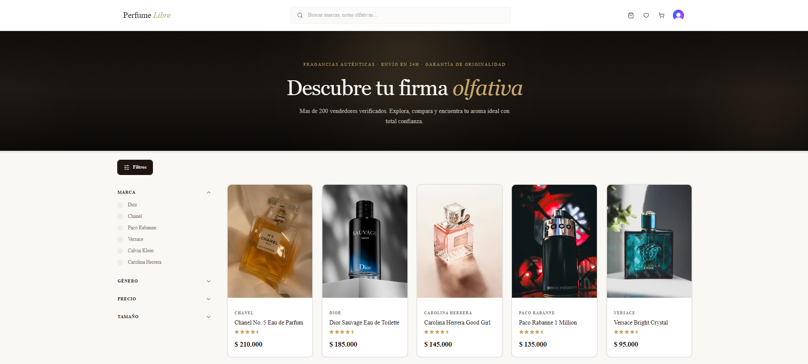
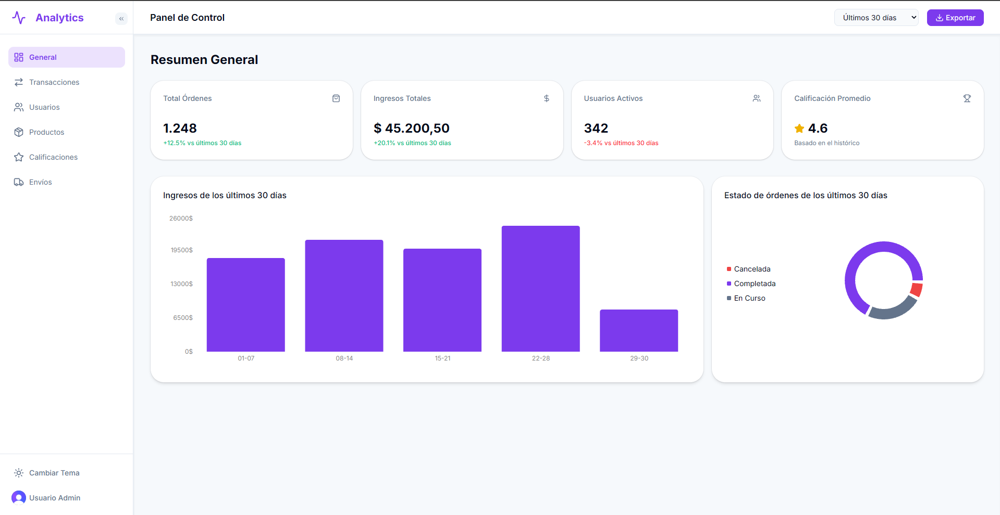
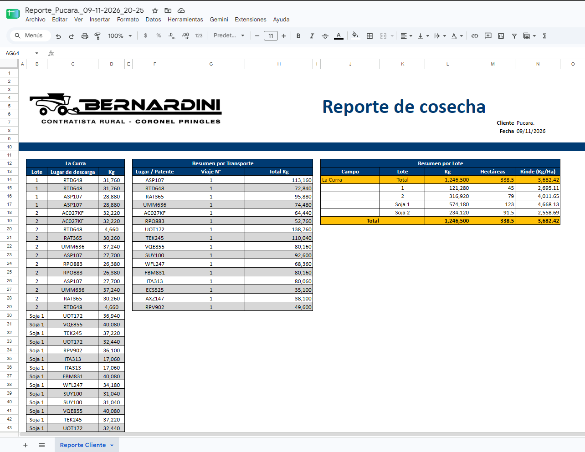
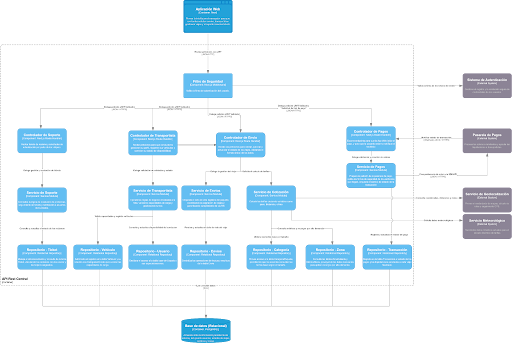

# Nicolás Bernardini

**Estudiante de Ingeniería en Sistemas de Información · Universidad Nacional del Sur**

Desarrollo aplicaciones web y móviles con foco en calidad, datos y en entender el problema que cada producto resuelve

📍 Bahía Blanca, Argentina

---

> Proyectos académicos (UNS) y desarrollos reales.

## Proyectos destacados

### 1. Marketplace de perfumes + Analytics Dashboard

Ecosistema de aplicaciones con arquitectura de microservicios, desarrollado en un equipo de 5 personas para la materia Ingeniería de Aplicaciones Web.

**Stack:** Next.js · TypeScript · PostgreSQL · Prisma · Clerk · Mercado Pago (sandbox) · Vercel

**Mi parte**

| Componente | Descripción |
|---|---|
| **Buyer App** | Registro e inicio de sesión, catálogo, carrito, historial de compras, panel de administración con gráficos, pagos con Mercado Pago (sandbox) y resumen automático de reseñas con IA. |
| **Control Plane** | Panel de superadministración. Desarrollo individual. |
| **Analytics Dashboard** | Desarrollo individual. Ingresos totales y por mes, ticket promedio, tasa de conversión, usuarios activos, calificación promedio y estado de las órdenes de los últimos 30 días, con filtros por rango de fechas. <!-- TODO: indicar cuántos indicadores son en total --> |

**Enlaces**

<!-- TODO: reemplazar link de Buyer App por el de producción (sin git-develop) y descomentar video cuando esté -->
<!--  -->

**Usuarios de prueba** (código de verificación: `424242`)

| Rol | Usuario | Contraseña |
|---|---|---|
| Administrador | `admin+clerk_test@iaw.com` | `iawuser#` |
| Comprador | `buyer+clerk_test@iaw.com` | `iawuser#` |

<b>📸 Capturas</b>

 

  
  
  

Catálogo · Panel de administración · Analytics Dashboard

---

### 2. App de gestión logística de cosecha

Aplicación móvil que digitaliza el control de la cosecha desde la cabina de la maquinaria. Reemplaza las libretas de papel, calcula la productividad automáticamente y genera reportes para los dueños de los campos. Desarrollo individual a partir de los requerimientos de un contratista rural.

**Stack:** Flutter · Dart · SQL (Almacenamiento local)

**Lógica y funcionalidades:**
* **Modelo jerárquico:** Organización por *Cliente → Campo → Lote (hectáreas) → Carga* (kilos, destino, fecha y chofer), calculando en tiempo real kilos totales, hectáreas trabajadas y rinde (kg/ha).
* **Arquitectura Offline-First:** Persistencia local para operar en zonas rurales sin señal y agrupamiento consistente de datos.
* **Recálculo retroactivo:** Edición de hectáreas o kilos con actualización automática de los rindes de toda la campaña.
* **Reportes de negocio:** Exportación directa a Excel y PDF filtrable por fecha, cliente, campo o camión.

**Estado y evolución:** Prototipo funcional validado en entorno de prueba. El desafío técnico principal fue diseñar la persistencia *offline* sin pérdida ni duplicación de registros. El próximo paso es integrar una plataforma web para seguimiento en tiempo real.

<b>📸 Captura del reporte generado</b>

 

  

---

### 3. Packeteer, plataforma de logística colaborativa

Plataforma que conecta a personas que necesitan enviar paquetes con conductores independientes. Proyecto de Arquitectura y Diseño de Sistemas (UNS), en equipo de 4 personas, con foco en el diseño y la documentación de la arquitectura.

**Stack:** Next.js · TypeScript · PostgreSQL · Prisma · Clerk · Vercel

**Mi aporte:**
* **Desarrollo Frontend:** Implementación completa de la interfaz, navegación y simulación de conductores en movimiento.
* **Arquitectura y Documentación:** Relevamiento de requerimientos funcionales/no funcionales, modelo de dominio y de datos, diagramas C4 (contexto, contenedores y componentes), especificación de APIs y registro de decisiones de arquitectura (ADRs).

**Decisiones clave:** Monolito en capas · *Polling* sobre HTTP en lugar de WebSockets para simplificar infraestructura · PostgreSQL sin capa de caché intermedia · Procesos *batch* automatizados con Vercel Cron.

<b>Diagrama</b>

 

  

---

## Otros proyectos académicos

| Proyecto | Descripción | Tecnologías | Enlaces |
|---|---|---|---|
| **Tracker de bíceps** | Equipo de 4. Seguimiento del brazo en video, cálculo del ángulo del codo y gráficos de las variables en función del tiempo. | Python · OpenCV · MediaPipe · NumPy | 🎥 [Demo](https://youtu.be/kwR4GyDo3C8) 📄&nbsp;[Proyecto](docs/Tracker%20de%20b%C3%ADceps/Proyecto%20de%20fisica%20-%20Curl%20de%20biceps.pdf) |
| **Gestión de un proyecto de software para una aerolínea** | *En curso.* Participé en la elaboración de la documentación de gestión como plan de riesgos, WBS, métricas de seguimiento y criterios de éxito, priorización de requerimientos y planificación en sprints. | Gestión de proyectos · UML · ProjectLibre | 📄&nbsp;[Documentación](docs/Aerol%C3%ADnea/documentacion.pdf) |
| **Nonograma** | Desarrollo individual. La lógica de reglas corre en SWI-Prolog y la interfaz en React, comunicados mediante Pengines. | Prolog · React | 🎥&nbsp;[Demo](https://youtu.be/YBS6UOwpd2A) 📄&nbsp;[Informe](docs/Nonograma/Informe.pdf) |
| **Clon de Candy Crush** | Equipo de 4. Diseño orientado a objetos aplicando patrones de diseño para la lógica del tablero, combinaciones y puntajes. | Java | 🎥&nbsp;[Demo](https://youtu.be/OViWHFBxXzg) |

---

## Tecnologías

**Datos, Backend y Arquitectura**

**Desarrollo Frontend y Mobile**

**Otros Lenguajes y Herramientas**

