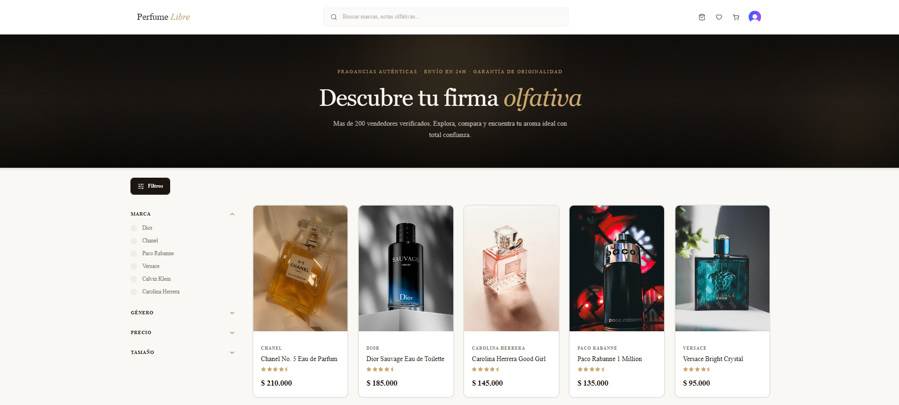
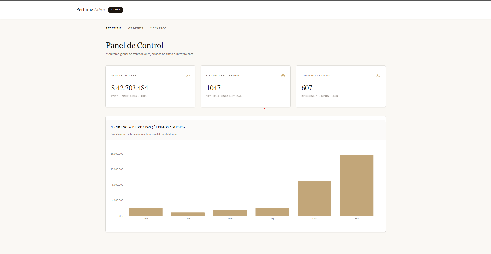
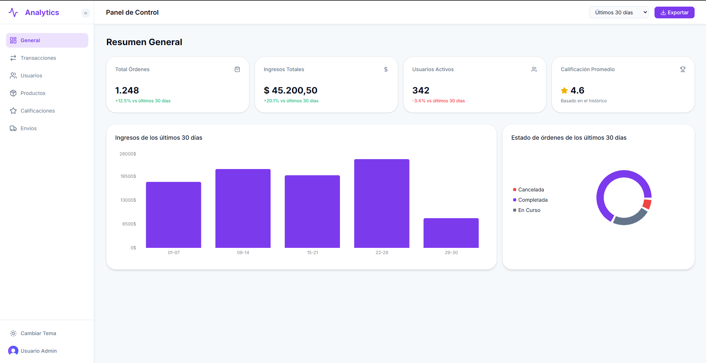
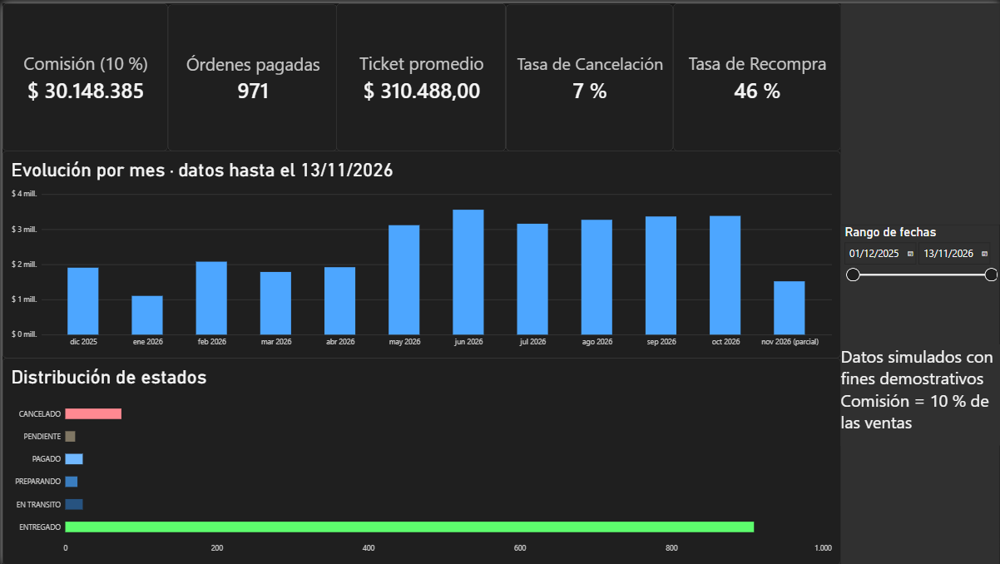
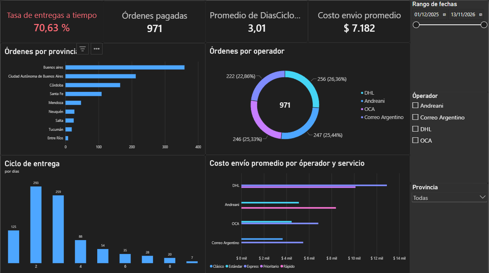
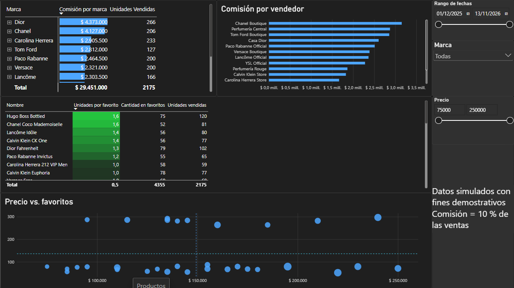
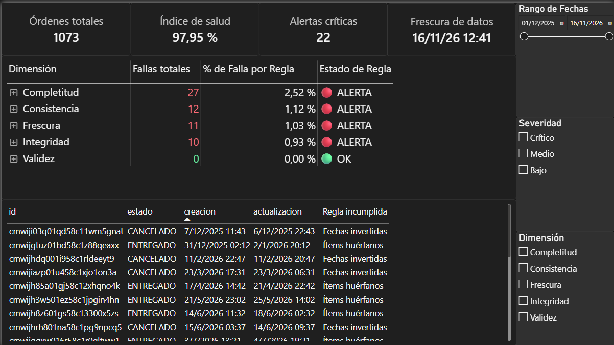
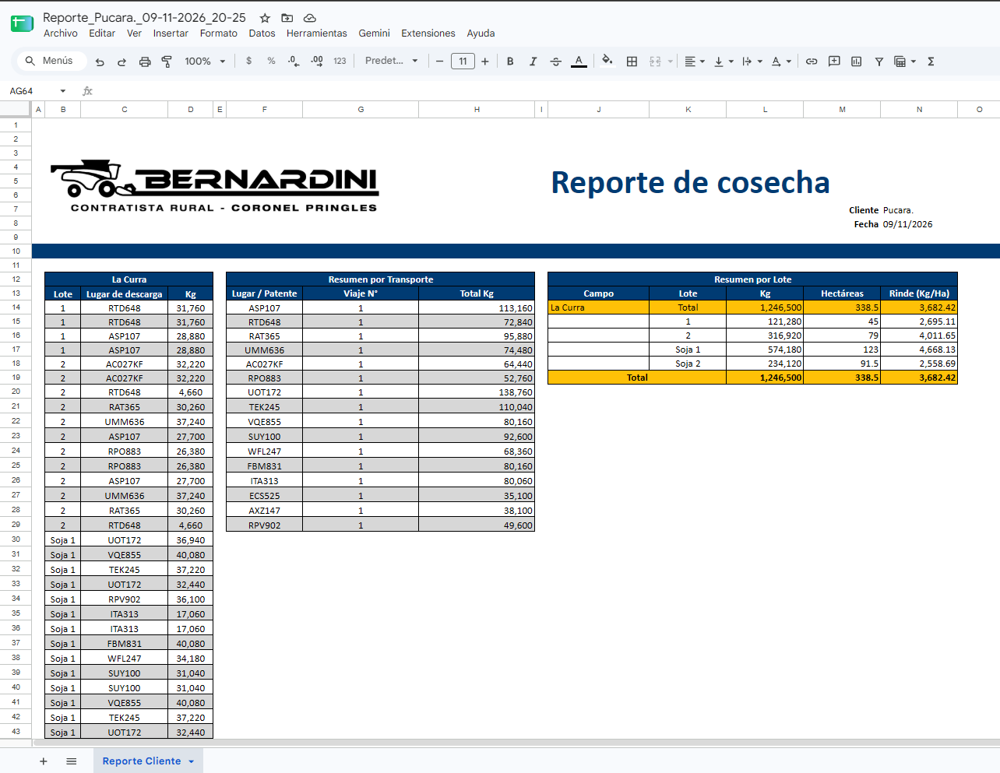
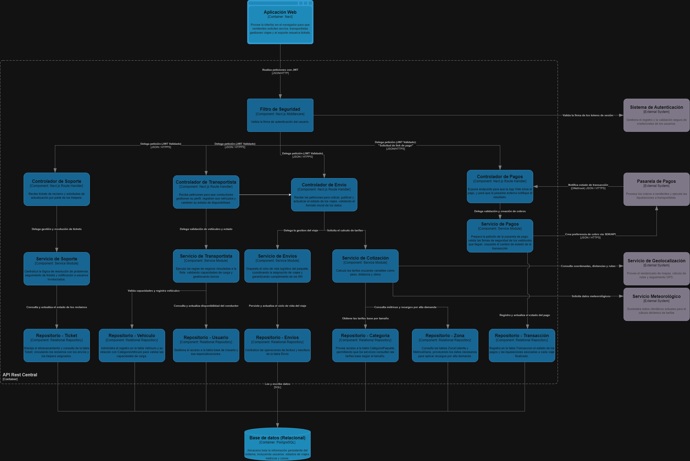

# Nicolás Bernardini

**Estudiante de Ingeniería en Sistemas de Información · Universidad Nacional del Sur**

Desarrollo aplicaciones web y móviles con foco en calidad, datos y en entender el problema que cada producto resuelve

📍 Bahía Blanca, Argentina

---

> Proyectos académicos (UNS) y desarrollos reales.

## Proyectos destacados

### 1. Marketplace de perfumes + Analytics Dashboard

Ecosistema de aplicaciones con arquitectura de microservicios, desarrollado en un equipo de 5 personas para la materia Ingeniería de Aplicaciones Web.

**Stack:** Next.js · TypeScript · PostgreSQL · Prisma · Clerk · Mercado Pago (sandbox) · Vercel

**Mi parte**

| Componente | Descripción |
|---|---|
| **Buyer App** | Registro e inicio de sesión, catálogo, carrito, historial de compras, pagos con Mercado Pago (sandbox) y resumen automático de reseñas con IA. Incluye testing unitario, pruebas de API con Postman y pruebas E2E con Playwright. |
| **Control Plane** | Desarrollo individual. Panel de superadministración: gestión de usuarios (suspender y reactivar cuentas), seguimiento de órdenes (estado de pago y envío), moderación de productos (suspender, reanudar, eliminar) y gestión de reportes. |
| **Analytics Dashboard** | Desarrollo individual. Más de 25 indicadores y visualizaciones organizados en cinco áreas: ventas (ingresos, ticket promedio, tasa de conversión, órdenes canceladas), usuarios (nuevos, recurrentes, crecimiento), catálogo (publicaciones activas y pausadas, top productos), reseñas y calidad (calificaciones, reportes, vendedores en riesgo) y logística (tiempo de entrega, envíos), con filtros por rango de fechas. |

**Enlaces**

**Usuarios de prueba** (código de verificación: `424242`)

| Rol | Usuario | Contraseña |
|---|---|---|
| Administrador | `admin+clerk_test@iaw.com` | `iawuser#` |
| Comprador | `buyer+clerk_test@iaw.com` | `iawuser#` |

<b>💳 Cómo probar un pago (Mercado Pago, modo sandbox)</b>

 

Los pagos se procesan en el entorno de pruebas de Mercado Pago, así que **no se realizan cobros reales**. Para comprar con la cuenta de comprador, completar el formulario del Checkout Brick con estos datos de prueba:

| Campo | Valor |
|---|---|
| Tarjeta de crédito | `5031 7557 3453 0604` |
| Tarjeta de débito | `5287 3383 1025 3304` |
| Vencimiento | `11/30` |
| CVV | `123` |
| DNI | `12345678` |
| Email | `ejemplo@gmail.com` (no usar `test@testuser.com`, que el sistema suele rechazar) |

El resultado del pago depende del **nombre del titular**:

| Nombre del titular | Resultado |
|---|---|
| `APRO` | ✅ Pago aprobado |
| `OTHE` o `CALL` | ❌ Pago rechazado |

<b>📸 Capturas</b>

 

  
  
  

Catálogo · Panel de administración · Analytics Dashboard

---

### 2. Pipeline de datos y tablero de ventas (Power BI)

Proyecto personal que arma el circuito completo del dato sobre el esquema del [marketplace de perfumes](#1-marketplace-de-perfumes--analytics-dashboard): extrae órdenes, ítems y envíos de PostgreSQL, los limpia y modela, y los presenta en un tablero de Power BI de cuatro páginas con un control de calidad de datos. Trabaja con datos simulados, generados con un script de sembrado.

**Stack:** PostgreSQL (Neon) · SQL · Power Query · Power BI · DAX

**Qué contiene el tablero**

| Página | Qué muestra |
|---|---|
| **Resumen** | Comisión total, órdenes pagadas, ticket promedio, tasas de cancelación y recompra, evolución mensual y distribución por estado. |
| **Logística y geografía** | Órdenes por provincia y por operador, costo de envío por operador y servicio, ciclo de entrega y tasa de entregas a tiempo. |
| **Productos** | Comisión por marca y por vendedor, unidades vendidas por favorito de cada producto y relación entre precio y favoritos. |
| **Calidad de datos** | Reglas por dimensión con semáforo, índice de salud, alertas críticas, frescura de los datos y detalle de los registros que fallan. |

**Cómo está construido**

- **Extracción:** consultas SQL sobre PostgreSQL (órdenes, ítems y envíos).
- **Transformación:** limpieza y normalización con Power Query (por ejemplo, valores escritos de distinta forma) y una tabla de calendario que marca el mes en curso como parcial.
- **Medidas DAX:** comisión, ticket promedio, tasas de cancelación y recompra, ciclo de entrega, entregas a tiempo y ventas por favorito.
- **Calidad de datos:** 7 reglas agrupadas en completitud, consistencia, integridad, frescura y validez, con semáforo por dimensión.

**Definiciones:** la comisión es el 10 % del valor de las ventas y el ticket promedio es el valor bruto de la orden. Los datos son simulados, así que los resultados no describen un negocio real.

**Limitaciones y próximos pasos:** el ciclo de entrega se aproxima con la diferencia entre creación y última actualización, porque no se guarda el historial de estados. Quedan pendientes la reconciliación automática contra la base y la actualización programada de los datos.

  

<b>📸 Más páginas</b>

 

  
  

  

---

### 3. App de gestión logística de cosecha

Aplicación móvil que digitaliza el control de la cosecha desde la cabina de la maquinaria. Reemplaza las libretas de papel, calcula la productividad automáticamente y genera reportes para los dueños de los campos. Desarrollo individual a partir de los requerimientos de un contratista rural.

**Stack:** Flutter · Dart · SQL (Almacenamiento local)

**Lógica y funcionalidades:**
* **Modelo jerárquico:** Organización por *Cliente → Campo → Lote (hectáreas) → Carga* (kilos, destino, fecha y chofer), calculando en tiempo real kilos totales, hectáreas trabajadas y rinde (kg/ha).
* **Arquitectura Offline-First:** Persistencia local para operar en zonas rurales sin señal y agrupamiento consistente de datos.
* **Recálculo retroactivo:** Edición de hectáreas o kilos con actualización automática de los rindes de toda la campaña.
* **Reportes de negocio:** Exportación directa a Excel y PDF filtrable por fecha, cliente, campo o camión.

**Estado y evolución:** Prototipo funcional validado en entorno de prueba. El desafío técnico principal fue diseñar la persistencia *offline* sin pérdida ni duplicación de registros. El próximo paso es integrar una plataforma web para seguimiento en tiempo real.

<b>📸 Captura del reporte generado</b>

 

  

---

### 4. Packeteer, plataforma de logística colaborativa

Plataforma que conecta a personas que necesitan enviar paquetes con conductores independientes. Proyecto de Arquitectura y Diseño de Sistemas (UNS), en equipo de 5 personas, con foco en el diseño y la documentación de la arquitectura.

**Stack:** Next.js · TypeScript · PostgreSQL · Prisma · Clerk · Vercel

**Mi aporte:**
* **Desarrollo Frontend:** Implementación completa de la interfaz, navegación y simulación de conductores en movimiento.
* **Arquitectura y Documentación:** Relevamiento de requerimientos funcionales/no funcionales, modelo de dominio y de datos, diagramas C4 (contexto, contenedores y componentes), especificación de APIs y registro de decisiones de arquitectura (ADRs).

**Decisiones clave:** Monolito en capas · *Polling* sobre HTTP en lugar de WebSockets para simplificar infraestructura · PostgreSQL sin capa de caché intermedia · Procesos *batch* automatizados con Vercel Cron.

<b>📸 Diagrama</b>

 

  

---

## Otros proyectos académicos

| Proyecto | Descripción | Tecnologías | Enlaces |
|---|---|---|---|
| **Tracker de bíceps** | Equipo de 4. Seguimiento del brazo en video, cálculo del ángulo del codo y gráficos de las variables en función del tiempo. | Python · OpenCV · MediaPipe · NumPy | 🎥 [Demo](https://youtu.be/6YeRl_z8iH8) 📄&nbsp;[Proyecto](docs/Tracker%20de%20b%C3%ADceps/Proyecto%20de%20fisica%20-%20Curl%20de%20biceps.pdf) |
| **Gestión de un proyecto de software para una aerolínea** | *En curso.* Participé en la elaboración de la documentación de gestión como plan de riesgos, WBS, métricas de seguimiento y criterios de éxito, priorización de requerimientos y planificación en sprints. | Gestión de proyectos · UML · ProjectLibre | 📄&nbsp;[Documentación](docs/Aerol%C3%ADnea/documentacion.pdf) |
| **Nonograma** | Desarrollo individual. La lógica de reglas corre en SWI-Prolog y la interfaz en React, comunicados mediante Pengines. | Prolog · React | 🎥&nbsp;[Demo](https://youtu.be/6K3Ythll-lg) 📄&nbsp;[Informe](docs/Nonograma/Informe.pdf) |
| **Clon de Candy Crush** | Equipo de 4. Diseño orientado a objetos aplicando patrones de diseño para la lógica del tablero, combinaciones y puntajes. | Java | 🎥&nbsp;[Demo](https://youtu.be/0E57nMYkHG4) |

---

## Tecnologías

**Datos, Backend y Arquitectura**

**Desarrollo Frontend y Mobile**

**Calidad**

**Otros Lenguajes y Herramientas**

